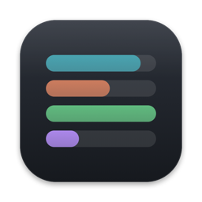

# Motas

**Motas = Mac + Quota.** A native macOS menu bar app that shows the AI
subscription quota held by your **remote AI proxies** — every account on every
server, in one place.

Tools like CodexBar read the accounts logged in on *this* Mac. Motas reads the
proxies you run for a team or a fleet: CLIProxyAPI and 9Router today.

- **Menu bar:** the headline pool's reserve, e.g. `Codex 51%`, a gauge for the
  next pool, and a warning sign for actionable problems.
- **Panel:** compact pool cards, then proxy → provider → account rows with
  every window (5-hour, weekly, 30-day…), remaining %, reset time and notes.
- **Model Pulse:** a native desktop widget with pool cards, per-account meters
  and LIVE / CHECK / OFF cards for unmetered providers.
- **WidgetKit widget** with the saved headline and the other measured pools.
- **7-day history** chart, one line per pool.
- **Notifications:** pool low, pool exhausted or available again, proxy down or
  back, and accounts that need re-login.
- **CLI:** `motas proxy …` adds, tests and edits proxies without opening the
  app.

Motas never invents a number: an account whose provider exposes no figures is
shown as unknown, a transient failed read keeps its last windows and is marked
stale, and with no proxy configured the app shows an empty state — there is no
demo mode.

## How it reads each proxy

| Proxy | Credential | What Motas calls |
|---|---|---|
| [CLIProxyAPI](https://github.com/router-for-me/CLIProxyAPI) | management key (`management.allow-remote: true` for remote URLs) | `GET /v0/management/auth-files`, then `POST /v0/management/api-call` per account — the proxy calls the provider's usage URL with that account's own token |
| [9Router](https://github.com/decolua/9router) | CLI token (recommended) or dashboard password | `GET /api/providers`, `GET /api/usage/{id}`; password mode also `POST /api/auth/login` |

Per-account quota through CLIProxyAPI is supported for Codex, Antigravity and
Claude. Motas does **not** use CLIProxyAPI's `/quota/fetch` (it returns 501 for
built-in providers without a plugin) or `/usage-queue` (reading it deletes
records), and never calls reset, switch, delete or config routes. Asking a
proxy for usage may make it refresh that account's token — the proxy owns those
tokens, so that is safe.

The 9Router CLI token is admin-equivalent and never expires. Motas sends it only
on the two read-only requests. The recipe is in Settings and in `motas --help`:

```bash
docker exec <container> sh -c 'd=${DATA_DIR:-$HOME/.9router}; printf %s%s%s "$(cat $d/machine-id)" 9r-cli-auth "$(cat $d/auth/cli-secret)" | sha256sum | cut -c1-16'
```

Credentials live only in the macOS Keychain, in one item. Settings
(`~/Library/Application Support/Motas/settings.json`), history and the shared
snapshot contain URLs, account labels, emails, plans, error messages and quota
numbers — never a secret.

## Install

```bash
brew install --cask --no-quarantine dinhkarate/motas/motas
```

Motas is not notarized, hence `--no-quarantine`.

## Build from source

Requires macOS 14+ and Swift 6.

```bash
swift build
swift test                      # parsers, pools, alerts, CLI and app model, against real fixtures
scripts/build-app.sh 0.3.0      # dist/Motas.app
```

Live checks against your own proxies (optional; run through `keyshroud`):

```bash
MOTAS_LIVE=1 MOTAS_CPA_URL=… MOTAS_CPA_KEY=… MOTAS_9R_URL=… MOTAS_9R_TOKEN=… \
  swift test --filter LiveTests
```

`MOTAS_9R_PASSWORD` may replace `MOTAS_9R_TOKEN`.

Offscreen renders (menu bar, panel, settings, editor, history, widgets) from the
offline production fixture:

```bash
swift run motas-render /tmp/motas-render
```

`--live` renders from a real 9Router (`MOTAS_9R_URL` plus `MOTAS_9R_TOKEN` or
`MOTAS_9R_PASSWORD`).

New fixtures come from a live proxy:

```bash
scripts/dev/capture-live.py       # raw/, may contain emails and ids
scripts/dev/sanitize-fixtures.py raw Tests/MotasCoreTests/Fixtures/live
```

`capture-live.py` reads `MOTAS_CPA_URL`, `MOTAS_9R_URL` and either
`NINE_ROUTER_CLI_TOKEN` or `NINE_PASSWORD` (plus `CPA_MGMT_KEY` and
`CPA_CLIENT_KEY`), records per-call timings in `raw/timings.jsonl`, and never
prints a secret. `sanitize-fixtures.py` replaces emails, ids and auth indexes
and refuses to write a file that still looks like a token.

## CLI

```bash
motas proxy list
motas proxy add --kind 9router --name Home --url https://9r.example --auth cli-token --secret-stdin
motas proxy test Home
```

Secrets are read from stdin (or a no-echo prompt on a terminal), never from
arguments. A running app receives every change immediately. Exit codes: 0 OK,
64 usage, 65 bad input, 69 proxy unreachable, 75 Keychain approval needed.

See [docs/architecture.md](docs/architecture.md) for the data flow, the pool
rules and what was learned from real responses. The v0.3 contract is
[docs/design-v0.3.md](docs/design-v0.3.md). The previous implementation is kept
under `legacy/` for reference.

## License

MIT. See [LICENSE](LICENSE).
