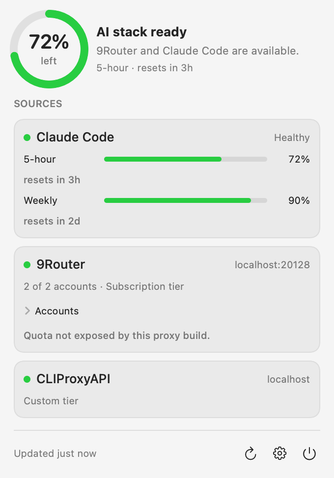

# Motas

**Motas = Mac + Quota**

Motas is a native macOS menu bar app that reads AI quota from your own proxy stack — CLIProxyAPI, 9Router, Claude Code — and shows it as a quota ring, per-window bars, and one conservative readiness state. It answers "can I start a long coding session right now?" without asking for provider credentials.



## Install

```bash
brew install --cask --no-quarantine dinhkarate/motas/motas
```

Motas is ad-hoc signed, not notarized, hence `--no-quarantine`.

## Build from source

```bash
swift build
swift test
swift run Motas
scripts/build-app.sh 0.1.0   # dist/Motas.app, Apple Silicon
```

Requirements: macOS 14+, Swift 6+. Command Line Tools suffice; full Xcode is not needed (and the old WidgetKit widget is gone).

`swift run Motas` launches the menu bar app. On first launch with no configured connector it starts in demo mode; save Settings to configure real monitoring.

## Connector setup

- **CLIProxyAPI** (default `http://localhost:8317`): enable in Settings → Sources, enter the endpoint, put the management key in the Keychain field. Motas probes `POST /v0/management/quota/fetch` per account. Accounts whose provider plugin exposes no quota endpoint (HTTP 501) show health only — that is expected.
- **9Router** (default `http://localhost:20128`): enter the endpoint plus a dashboard or CLI token. Motas probes `GET /api/usage/{connectionId}` per active connection. Never appends `?force=1`.
- **Claude Code**: configure `scripts/motas-claude-statusline` as Claude Code's `statusLine` command, then set `MOTAS_CLAUDE_CODE_ENABLED=1`. See [Claude Code connector setup](docs/connectors/claude-code.md).

Environment overrides (development only, take precedence, never imported into Keychain):

```text
MOTAS_CLAUDE_CODE_ENABLED
MOTAS_CLAUDE_STATUS_FILE
MOTAS_9ROUTER_URL / MOTAS_9ROUTER_DASHBOARD_TOKEN / MOTAS_9ROUTER_CLI_TOKEN
MOTAS_CLIPROXYAPI_URL / MOTAS_CLIPROXYAPI_KEY / MOTAS_CLIPROXYAPI_MANAGEMENT_KEY
```

Non-secret Settings live in `~/Library/Application Support/Motas/settings.json`. Read [Settings, Keychain and refresh architecture](docs/architecture/settings-keychain-auto-refresh.md) for storage, precedence, and refresh behavior.

## Privacy boundary

- Proxy credentials live only in Keychain (or dev-process environment).
- The persisted snapshot, history, logs and diagnostics contain normalized percentages and masked labels only — no keys, no tokens, no raw responses.
- Every proxy call is read-only. Motas never touches reset, switch, start or stop endpoints.
- Motas never invents a percentage, a reset time, or a green state. No data means partial, not healthy.

## License

MIT. See [LICENSE](LICENSE).

## Architecture

- [Goal and non-negotiables](GOAL.md)
- [Normalized status model](docs/architecture/normalized-status-model.md)
- [Readiness rules](docs/architecture/readiness-rules.md)
- [Settings, Keychain and refresh](docs/architecture/settings-keychain-auto-refresh.md)
- [Readiness notifications](docs/architecture/notifications.md)
- [Bounded status history](docs/architecture/status-history.md)
- [Sanitized diagnostics](docs/architecture/diagnostics.md)
- [Truthful status presentation](docs/architecture/status-presentation.md)
- [Guided setup and connection testing](docs/architecture/connection-testing.md)
- [Claude Code connector](docs/connectors/claude-code.md)
- [9Router connector](docs/connectors/9router.md)
- [CLIProxyAPI connector](docs/connectors/cliproxyapi.md)
- [Frozen v1 scope](docs/product/v1-scope.md)
