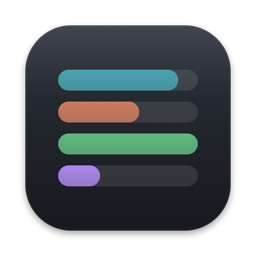

# Motas

**Motas = Mac + Quota.** A native macOS menu bar app that shows the AI
subscription quota held by your **remote AI proxies** — every account on every
server, in one place.

Tools like CodexBar read the accounts logged in on *this* Mac. Motas reads the
proxies you run for a team or a fleet: CLIProxyAPI and 9Router today,
OmniRoute and new-api next.

- **Menu bar:** the lowest pool reserve, e.g. `Codex 64%`, with a warning
  sign when a pool runs low or a proxy is unreachable.
- **Panel:** proxy → provider → account, each window with its real label
  (5-hour, weekly, 30-day…), remaining % and reset time.
- **Notifications** when a pool crosses your threshold or a proxy goes down
  or comes back.
- **Widget** with the lowest pool, and a **7-day history** chart.

Motas never invents a number: an account whose provider exposes no figures is
shown as unknown, a failed read counts as empty, and with no proxy configured
the app shows an empty state — there is no demo mode.

## How it reads each proxy

| Proxy | Credential | What Motas calls |
|---|---|---|
| [CLIProxyAPI](https://github.com/router-for-me/CLIProxyAPI) | management key (`management.allow-remote: true` for remote URLs) | `GET /v0/management/auth-files`, then `POST /v0/management/api-call` per account — the proxy calls the provider's usage URL with that account's own token |
| [9Router](https://github.com/decolua/9router) | dashboard password | `POST /api/auth/login`, `GET /api/providers`, `GET /api/usage/{id}` |

Per-account quota through CLIProxyAPI is supported for Codex, Antigravity and
Claude. Motas does **not** use CLIProxyAPI's `/quota/fetch` (it returns 501
for built-in providers without a plugin) or `/usage-queue` (reading it deletes
records), and never calls reset, switch, delete or config routes. Asking a
proxy for usage may make it refresh that account's token — the proxy owns
those tokens, so that is safe.

Credentials live only in the macOS Keychain. Settings
(`~/Library/Application Support/Motas/settings.json`), history and the shared
snapshot contain URLs, names and numbers only.

## Install

```bash
brew install --cask --no-quarantine dinhkarate/motas/motas
```

Motas is not notarized, hence `--no-quarantine`.

## Build from source

Requires macOS 14+ and Swift 6.

```bash
swift build
swift test                      # parsers and app model, against fixtures captured from real proxies
scripts/build-app.sh 0.2.0      # dist/Motas.app
```

Live checks against your own proxies (optional):

```bash
MOTAS_LIVE=1 MOTAS_CPA_URL=… MOTAS_CPA_KEY=… MOTAS_9R_URL=… MOTAS_9R_PASSWORD=… \
  swift test --filter LiveTests
```

`scripts/dev/capture-live.py` and `scripts/dev/sanitize-fixtures.py` record new
fixtures from a live proxy and strip emails, ids and tokens before they are
committed.

See [docs/architecture.md](docs/architecture.md) for the data flow, the pool
rules and what was learned from real responses. The previous implementation is
kept under `legacy/` for reference.

## License

MIT. See [LICENSE](LICENSE).
